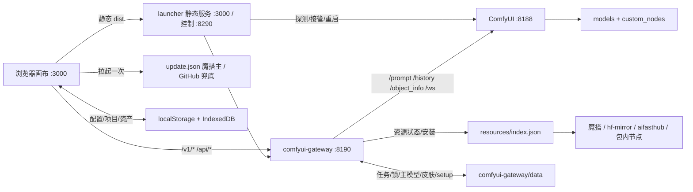

# 无界工作台 · 程序架构

> 截至 2026-10-30，对应发布版本 **v0.22.9**（发布树 `07842353-release-staging`）。
> 本文件是架构层权威说明，已纳入 staging git（`docs/ARCHITECTURE.md`），不进发布包。状态与待办见 `docs/HANDOFF.md`，历史见 `docs/RELEASE-HISTORY.md`。
> 版本/索引/路由/包数等数字为 2026-10-30 实测（网关单测 184/184、启动器 8/8；v0.22.8 含工作流推送与 UI 辅助节点修复）；`docs/` 不入发布包。

## 1. 定位

本地 Windows 上的「无限画布 + 本地 ComfyUI 网关」：画布负责项目、节点、素材与交互；网关把 ComfyUI 工作流包装成 OpenAI 兼容接口；启动器负责探测/接管/拉起 ComfyUI、网关与画布；资源安装器扫描已有模型、按硬件推荐版本、缺什么下什么；更新器每次拉起检查一次远端版本。

## 2. 总览



## 3. 组件职责

| 组件 | 位置 | 职责 |
|---|---|---|
| 启动器 | `launcher/start.mjs`（零依赖） | 探测/接管 ComfyUI；拉起网关；托管画布 dist；控制接口；会话看门狗 |
| 网关 | `comfyui-gateway/src`（34 个模块，约 11.8k 行） | Express 5；OpenAI 兼容接口；工作流注册/绑定/运行；资源安装；更新；任务；预览 |
| 画布 | `infinite-canvas/web` | React 19 + Vite + Zustand + antd + Tailwind/shadcn；构建为静态 `dist` |
| ComfyUI | 外部安装（路径由启动器探测） | 执行工作流；模型与自定义节点 |
| 工作流 | `comfyui-gateway/workflows` | 20 个已注册 API 工作流 JSON + `registry.json` |
| 资源安装 | `src/resources.js`（约 2.5k 行）+ `resources/` | 索引/包/依赖；多源下载；节点随包；主模型；硬件推荐 |
| 更新 | `update.json` + `src/update.js` + 画布 hook | 检查、应用、横幅提醒 |

## 4. 启动与接管

1. `start-local.bat` → `launcher/start.mjs`。
2. 探测顺序：安装器同文件夹 → 同盘限深（约 2s）→ 常见目录/配置（含桌面版路径）→ 端口并行探测（见第 5 条）→ 手动配置；已在运行的进程直接接管，绝不重复启动。
3. 网关缺 `express`/`multer` 时自愈：用 `launcher/gateway-deps.zip`（否则魔搭下载 + SHA 校验）解到 `.update/gateway-deps/`。
4. 网关默认 `:8190`，环境 `PORT`、`HOST`、`COMFY_URL`、`COMFYUI_DIR`、`COMFY_WORKFLOWS_DIR`、`LAUNCHER_CONTROL_URL`；启动前等 `/health` 30s。
5. ComfyUI 定位与拉起（2026-10-29 扩展）：端口并行探测 `config/comfyUrl` → 8188 → 8000（桌面版默认）→ 7860/8080/8888/18000 → 8189–8199，可用 `COMFY_PORT_SCAN=9000-9010` 追加范围；安装目录额外查 `%LOCALAPPDATA%\Programs\@comfyorgcomfyui-electron`（含 `resources/ComfyUI`）。拉起顺序：桌面版 exe → 内容调用 `main.py` 的启动脚本（含任意/中文文件名，父目录也扫）→ 包内 `python.exe main.py --port <空闲端口>`。
6. ComfyUI 发现与重连：网关客户端连不上时扫本机常见端口（8188/8000/7860/8080/8888/18000/8189–8199），命中后自动切换；setup 每 10s 检查连通性，ComfyUI 上线/换地址会自动重扫。设置 → 偏好设置可切「手动指定」，填 ComfyUI/模型/LoRA/插件目录，保存写入 ComfyUI `extra_model_paths.yaml` 的托管块（备份原文件；只映射目录里实际存在的模型子目录，扁平目录才回退为通用映射），由启动器 `POST /set-comfy-dir` 记录新目录；保存时用 live `folder_paths` 判断是否已在清单里，只有缺失目录或 YAML 内容变化才要求重启 ComfyUI。相关接口：`GET/POST /api/setup/directories`、`POST /api/setup/directories/scan`、`POST /api/setup/pick-directory`（本机 PowerShell 原生文件夹对话框，远程模式禁用；选中后回填，文本输入保留作兜底）。
7. setup 扫描与可用性：
   - **刷新点**：启动、工作流目录变化、资源安装/切换主模型、ComfyUI 重连、资源中心「重新扫描」（`POST /api/resources/refresh` → `setup.scan()`，按钮自带 loading）。
   - **执行期模型匹配顺序（自选最高）**：用户显式「自选替换」→ 精确命中 → 自动同名 → 深目录唯一后缀 → 相似匹配。
   - **精确命中短路**：原文件已在 ComfyUI 列表里时直接返回，不再做相似替换，避免 4B/8B、turbo/raw 互相顶替。
   - **相似匹配**：格式相同、名称相似度 ≥50%、家族词加权；禁止跨规模、跨家族、turbo/raw 互顶；同族不同量化允许；候选分数接近时不猜。
   - **模型列表推送（2026-10-30 修复）**：`GET /api/models/events` 通过 SSE 广播 `models` 事件；工作流启用/隐藏和 `setup.scan()` 完成后触发，前端订阅并重新拉 `/v1/models`。`useLocalGatewaySync` 不再依赖 `LOCAL_ONLY`，只要存在本地渠道就同步，窗口聚焦/可见时补拉，8 秒轮询兜底。
   - **激活规则**：`validateWorkflow` 逐 variant 校验，**任一 variant 可跑入口就可用**；精确、相似、自选都算齐全；`phase=degraded` 时不可用；磁盘有文件但 `/object_info` 未列出 → 标「待重启」而不是缺模型。
   - **不做周期性全量扫描**：2026-10-29 曾加过模型目录 mtime 轮询与 10 分钟兜底重扫，评估后撤掉；只保留 10s 连通性检查。扫描成本交给用户手动触发，避免周期性拖慢 ComfyUI。
   - **扫描维度**：节点类名 + 模型文件 + 运行期依赖（pip 运行库 / TRT 编译产物 / 自定义节点，由 `resources.runtimeProblemsFor()` 提供，带 30s 缓存）；ComfyUI `workflows/` 下 `*-draft*`、`*副本*`、`*test*` 等草稿不再导入 registry，已导入的旧草稿会在扫描时移除登记（不动文件）。
8. 画布由启动器在 `:3000` 托管 dist（SPA 回退、`/assets` 长缓存、路径逃逸 403），每次启动重写 `dist/config.js` 注入网关地址。
9. 控制口 `:8290`：`GET /health`、`POST /restart-gateway`（接管来的网关返回 409）、`POST /restart-comfy`（taskkill 全部监听 PID → 等端口释放与显存回落 → 按同一套启动计划重新拉起 → 重探端口列表）。网关以 `/api/system/restart-comfy` 暴露同一能力。
10. 看门狗 5s：时钟跳变 >60s 先静默 120s；要求见过会话、`count==0`、`activeTasks==0`；**只有页面显式关闭**（pagehide/beacon → 网关记录 `closedAt`）且关闭时间在 10 分钟内、空闲 ≥`canvasIdleGraceSec`（默认 30s）才停后台；心跳缺失（后台标签节流/冻结、浏览器崩溃）一律不停，避免挂机被误杀。
11. 显式关闭语义（2026-10-29 补齐）：`sessions.js` 在 `status()` 中返回 `startedAt`/`closedAt`（此前只删会话、不记录关闭时间，导致启动器 `closedAt` 判定永远为假、自动退出实际不生效）；网关重启后 `startedAt` 变化会让启动器重置 `seen`，重新等待画布心跳。旧配置里残留的 15s 默认值会按 30s 处理，需要 15s 可显式设 `CANVAS_IDLE_GRACE_SEC=15`。
12. 状态条数据：`GET /api/system/stats` 由网关调 `nvidia-smi`（8s 超时，`System32` 兜底）；显卡满载导致读取超时时沿用上次读数并标记 `gpuStale`，界面注明「读取超时，显示上次读数」，不再变成「显存 --」。ComfyUI 离线时状态条显示「ComfyUI 离线 · 点击修复」，弹窗内可重新检测或一键重启。
13. 生成执行：`runWorkflow` 捕获 `OutOfMemory` 后调 `/free`（unload_models + free_memory）并重试一次，仍失败返回 `comfy_out_of_memory` 中文可行动提示；扩图/重绘强制单张、outpaint 采样按显存/配置封顶（默认 4MP）；视频超分按显存分档收敛（≤18GB 1024/1，≤26GB 1280/2）；插帧输出帧率 = 源 fps × 倍率。
14. 画布端口：默认 3000，被占用时自动尝试 3001–3010；`/config.js` 由启动器动态生成，`npm run build` 清空 dist 也不会丢网关地址。启动器识别 python 时覆盖 `python_embeded / python / env/python / env/Scripts / ..\python` 等整合包布局，并实际执行 `python -c` 探活。
15. 多机访问（v0.22.2）：`launcher/config.json` 新增 `allowLan`、`canvasHost`、`gatewayHost`、`gatewayPublicHost`、`corsOrigins`，默认仍只绑 `127.0.0.1`；非回环监听必须显式 `allowLan: true`，否则启动器拒绝启动。内部健康检查/旧端口代理始终走 `127.0.0.1`，`gatewayPublicHost` 只写入前端运行时网关地址；`gatewayHost` 非回环时设置 `ALLOW_REMOTE=1` 并透传 `CORS_ORIGINS`。放开绑定后仍无内置鉴权（除非另设 `GATEWAY_TOKEN`），只限可信内网；更新器保护 `web/dist/config.js` 不被补丁覆盖。
## 5. 生成链路

- **图片**：图片节点 → `services/api/image.ts` → `POST /v1/images/generations` / `/edits` → `runner` → `registry` → `bindings` → ComfyUI `/prompt` → 轮询 `/history` → 回传。v0.22.2 起，非 Qwen 多图编辑会在网关剥离前端「参考图片编号 / Reference image labels」协议头，避免 Krea2 等不读参考图的模型把它画成文字；Qwen 多图编辑仍重建图片顺序说明。`count>1` 并发单图；本地加 `X-Request-Id`，取消走 `POST /api/requests/:id/cancel`，进度走 `/api/progress/:requestId`（250ms）。
- **超分**（v0.21.18）：`POST /v1/images/upscale`、`/v1/videos/upscale`；4 条工作流——ESRGAN 快速放大（x2/x4/anime）、ESRGAN 2×（VHS 取帧/合片 + 核心 `UpscaleModelLoader`/`ImageUpscaleWithModel`，不依赖 WAS 节点）、SeedVR2 图片、SeedVR2 视频。
- **H3 视频**：`POST /v1/videos`（multipart，`mode=text|frames|reference`）→ 任务制；`GET /v1/videos/:id`、`/content`、`/cancel`。6 个入口 = VDN 三档（默认）+ 无VDN 三档，共 9 NFE（快速 6 低 + 3 高；质量 5 + 4）。VDN 可用性会检查 `vdn/stage-dmd-step-250` 整套文件（model、turbo/default adapter、config）；缺 Stage-B adapter 时工作流提前不可用并给出重下指引。源视频走原生 `LoadVideo → GetVideoComponents` 只取帧，`length` 由 ffprobe 帧数写入；音频由 H3 生成，源音频不保留。角色替换没有手选时长，按官方上限跟随：ffprobe 时长 × 24fps → 17n+5 向下对齐 → **封顶 362 帧（15 秒）**，参考视频策略 `model_minimum`；ffprobe 探不到时用前端上报的 `source_duration_seconds × 24` 换算。超过 15 秒的部分不参与生成（任务记 `source_video_truncated`，画布显示提示）；官方要求长视频走滑动窗口 relay，自动分段/拼接尚未实现。2026-10-30 之前不封顶的版本在长视频上会把参考整段塞进内存，RAM 可涨到 90GB+。当前 VDN+SelfLift 组合与作者 turbo8 示例（480p/124 帧/er_sde）未做 A/B，替换质量待真机确认。
- **上传上限**：multer 单文件 512 MB（`MAX_UPLOAD_BYTES` / config `maxUploadBytes` 可调），超限返回 413 中文提示；视频参考直接走内存，不再沿用旧的 50 MB 默认值。
- **插帧**：`POST /v1/videos/interpolate`（RIFE 2×/3×，任务制，生成右侧子视频节点，不覆盖原片）。
- **提示词**：`/v1/prompts/optimize`（H3/生图）、`/optimize-image`、`/caption`（`qwen35|florence|cloud`）。本地走 ComfyUI 工作流，云端走 OpenAI 兼容 `/chat/completions`；云端 Key 只在浏览器 localStorage。H3 云端加载官方 skill（`prompts/skills/h3-prompt-writing/`）。
- **自由卡片**：`/api/free-workflows/*`（导入/扫描/同步/UI 图）+ `/v1/free-workflows/:id/images|videos`；UI 工作流经 `ui-workflow.js` 用 `/object_info` 转成 API 图。
- **预览**：ComfyUI WS → `preview-hub.js` → `GET /api/previews/:promptId`（base64 + `X-Preview-Step/Total`）；`step-plan.js` 估总算子步数，未知节点类别回退到事件步数。

## 6. 工作流与模型

- **注册表 20 条**（实测）：H3 7（`ref2va/t2v/frames` × VDN/无VDN + `character-swap`）、MOSS 4（SFT 8/50、INT8 SFT 8/50；Balanced 已移除）、千问 2.1 2（t2i / edit / inpaint / outpaint 走 variants，`angle` 隐藏）、Krea2 2（`aesthetics` 隐藏、保留作质量二采）、Z-Image 1、超分 4。
- 工作流是 ComfyUI **API 格式** JSON；`registry.json` 存绑定、参数预设、`baseModels`、可见性默认值；FLUX.2 Klein 在 `workflows/_archive`，未注册。
- `model-paths.js` 统一 10 类模型目录（`MODEL_DIRS`/`MODEL_DIR_KEYS`，含 `upscale_models`、`SEEDVR2`、`vae_approx`、`vdn`）；v0.21.18 起可经 ComfyUI `/internal/folder_paths` 反推安装根，并按 `extra_model_paths` 匹配已装模型。
- 模型权重不进仓库；轮换与 TRT 编译脚本在 `comfyui-gateway/scripts/`（如 `build-h3-trt-vae.py`）。

## 7. 资源安装

- 索引 `resources/index.json` 版本 **2026.10.30-29**：**8 包 / 70 资源**——`core`（0 资源，按工作流依赖）、`moss` 6/4 工作流、`qwen21` 4/2、`zimage` 4/1、`krea2` 4/1、`h3` 21/7、`prompt-local` 4、`upscale` 11/4（6 权重 + 5 运行库）。
- 依赖以 `workflowDependencies` 按工作流展开，共享资源去重；模型选择器只列 setup 判定可用的工作流，缺资源即从 `/v1/models` 移除。
- **不变量：节点只随包，不写进 `workflowDependencies`**（单测强制）；节点由启动器 `bootstrap-nodes.mjs` 复制到 `custom_nodes/`。节点“已装”的判定：目标目录存在，**或** `provides` 里的类全部出现在 ComfyUI `/object_info`（用户装了同插件的另一个目录名也算已装）；启动器复制前同样按类检查，避免重复安装。
- 资源卡模型判定顺序：用户显式别名（最高，标 `alias`）→ 精确相对路径 / 同名文件（大小一致优先）→ 唯一体积匹配 → 相似匹配（标 `similar` + 相似度）；主模型覆盖与同族底模回退在资源状态里单独计算。执行期改写顺序见 §4.7。
- 运行库（`type:"pip"`）：按 `module` 导入名 + `pipName` 检测是否已装，缺失才装；`wheelMatrix` 条目可只给 `url/size/sha256`（不写 python/torch/cuda 约束）表示纯 Python 通用包，任意运行时都匹配。安装走 `pip install --no-deps`，先备份原包，失败自动回滚；装完重新 import 校验，失败同样回滚。
- 超分运行库（2026-10-29 补）：`seedvr2_dep_diffusers`（diffusers 0.33.1）、`seedvr2_dep_rotary`、`seedvr2_dep_omegaconf`（2.4.0，不再依赖 antlr4）、`seedvr2_dep_opencv`（cv2）、`seedvr2_dep_einops`——全部走阿里云 PyPI 镜像，挂到两条 SeedVR2 工作流；`peft`/`gguf`/`matplotlib` 节点代码未在导入期使用，不随包下发。
- 多源：魔搭主源、hf-mirror / aifasthub 备源；Range 续传，跨源先丢弃旧 `.part`；SHA256 校验；锁 `data/resource-lock.json`；文件并发 2。
- 随包节点（`type=node && autoInstall`）由 `launcher/bootstrap-nodes.mjs` 在启动时复制到 `custom_nodes/`：先解到同盘 `.canvas-install` 再原子 rename；幂等按「目标目录存在或 `provides` 类已加载」判断。
- 主模型：`data/main-models.json`。可把已装本地微调设为某包工作流默认底模；被替代的包内默认模型标「已用自选」、不计 missing、不阻塞安装。
- 资源卡工作流徽章：缺资源 → 「缺 N」；只有节点类缺失（文件已装、ComfyUI 未加载）→ 「待重启」；模型名不匹配等其余不可用 → 「模型名未匹配」，不再一律显示「待重启」。
- 硬件：`nvidia-smi` 显存 + 系统 RAM；显存只承担激活/工作区，权重超出部分按 ComfyUI 内存卸载计入 RAM；8GB 推荐 INT8；界面不显示 VRAM 数字。
- 许可：CC-BY-NC-SA 模型不随分发源提供（4x-UltraSharp / 4x-AnimeSharp 已从索引与魔搭数据集撤下）。

## 8. 更新链路

- 清单 `update.json`：魔搭主源，GitHub raw 兜底，可用 `UPDATE_MANIFEST_URL(_BACKUP)` 覆盖。
- 应用内：`GET /api/update/check?fetch=1`、`POST /api/update/apply`（有任务在跑返回 409）。git 安装走 `fetch` + `pull --ff-only`（脏树拒绝）；归档安装校验 `size`+`sha256`，支持 `PATCH-DELETE.txt`、`PATCH_PROTECTED` 白名单保护，失败回滚，成功后 1.5s 调 launcher `/restart-gateway`。
- 脏工作区：`git status --porcelain --untracked-files=no` 解析后忽略启动器生成的 `infinite-canvas/web/dist/config.js`；真实源码改动仍返回 `dirty`/`dirtyFiles`。真脏或 Git 不可用时，`POST /api/update/apply` 带 `force:true` 可改用已签名补丁覆盖程序文件，保留 data/models/node_modules/config，失败回滚；前端提供「强制更新（保留 data）」二次确认。
- 归档补丁：更新器优先用 Windows `System32\tar.exe` 解压，PowerShell `Expand-Archive` 兜底并保留两边错误；默认清单超时 30s、补丁下载/应用 600s；`GET /api/update/progress` 提供下载进度、总量与速度。
- 旧客户端：`patches/update-bridge.zip`（5,945 B）——解析版本 → 下载补丁 → 校验 → 解压时跳过受保护路径 → 备份到 `.update-backup` → 重启。
- 前端：`use-version-check` 每会话检查一次；`UpdateAvailableBanner` 每 10 分钟重查；只提示，不做静默下载/自动重启（用户已否决）。

## 9. 存储

- 浏览器：IndexedDB（项目/节点 400ms 防抖快照、资产库、`image_files`/`image_previews`/`media_files`）；localStorage（配置/主题/插件/皮肤本地状态）。`blob:` 地址不持久，持久引用只有 `storageKey`。
- 网关 `data/`：`tasks.json` + `outputs/`、`setup-status`、`resource-lock`、`main-models`、`workflow-visibility`、`free-workflows.json`、`skin-unlocks.json`。
- 不发布：`data/`、`models/`、`logs`、`launcher/config.json`、`node_modules`。

## 10. 安全

- 默认只绑回环；CORS 白名单；非 GET/HEAD/OPTIONS 的跨站写请求直接 403（校验 `Origin` 与 `Sec-Fetch-Site`）。
- `ALLOW_REMOTE=1` 且设置 `GATEWAY_TOKEN` 时，`/api/*` 与 `/admin` 需 `x-gateway-token`；只开 `ALLOW_REMOTE` 不设令牌会在启动时告警，接口仍无鉴权。
- 云端 Base URL 默认拒绝 loopback/内网/link-local/`.local`（`ALLOW_PRIVATE_CLOUD=1` 放行）。
- 导出配置按 `*ApiKey` 后缀脱敏，导入时回填；Key 不进仓库与文档。

## 11. 运行与测试

```bash
# 整套启动
start-local.bat            # 保持画布页打开；关页 30s 后停后台，见 §4 第 10 条

# 网关单测（2026-10-30 实测 184/184）
cd 07842353-release-staging/comfyui-gateway
COMFYUI_DIR=C:/ComfyUI node --test --test-timeout=120000 test/*.test.js

# 前端
cd ../infinite-canvas/web && npm run typecheck && npm run build

# 构建补丁（必须在最后一次 build 之后）
node ../../tools/build-patch.mjs --root ../.. --out ../../patches/v0.22.8.zip --write-manifest
```

端口：画布 3000、启动器控制 8290、网关 8190、ComfyUI 8188（探测 8188–8199）。

## 12. 发布

- 源是 `07842353-release-staging`（唯一 git 仓库）。目标是 GitHub 公开仓库 `main`、魔搭公开 dataset `master`（LFS 跟踪 `web/dist` 等，clone 别装 lfs filter 否则拿到指针）、夸克程序包 + 程序升级目录。
- 顺序：改 `VERSION`/`CHANGELOG` → 构建前端 → `build-patch --write-manifest`（白名单打包；守卫：CHANGELOG 必须含该版本、dist 必须引用新 `index-*.js` 且其中含版本串）→ 上传 → 匿名核验。
- 补丁哈希不可复现（tar 时间戳），必须在最后一次构建后写 manifest（`4616c53` 即为补救该问题）。
- `docs/` 与 `tools/` 不进补丁；`resources/bundled/` 与 `resources/loras/*.safetensors` 被 `.gitignore` 排除但发布包需要 → **从 git clone 得到的是轻量版**，完整包只能取补丁/程序包。
- 本文件已提交进 staging git 仅作追溯，不随发布物分发。

## 13. 已知限制 / 待办

- **P1**：LAN/远程网关自动发现与多网关故障切换；桌面包目录名仍带旧版本号；桌面快捷方式 AV 误报。
- **P2**：已装资源 sha/版本校验；H3 15 个权重缺 sha；真实 GPU TRT 首次编译（需用户授权）；补丁上传脚本化；旧 dist 残留；并发安装无互斥；`present` 只判文件存在；TRT 直写最终路径；`installNode` 的 `bundleDir` 未做根目录包含校验。
- **功能**：Qwen3.5-9B 主模型 5.7GB 与反推推理未实测；VDN 偶发闪烁未彻底解决，无VDN 作为回退；H3 显存接近 32GB。
- **超分**：运行库已接入索引并验证下载/安装/导入（py3.12、无 antlr4），但**没在干净机器上走完整安装流程**；`video-esrgan_2x` 去掉 WAS 依赖后未跑 GPU 出片。

## 14. 交接入口

- `docs/HANDOFF.md`：当前版本、本机实例、未发布改动、发版清单与红线（先读这个）。
- 本文件：架构与运行链路。
- `docs/RELEASE-HISTORY.md`：v0.22.3–v0.22.6 发版细节。
- `docs/FEEDBACK-BACKLOG.md`：用户反馈待办。
- `../07842353/docs/PROJECT_LOG.md`：开发树历史日志（追加式，仅本地）。
- 具体行为以 `comfyui-gateway/workflows/*.json`、`resources/index.json`、`comfyui-gateway/src/*` 为准。
