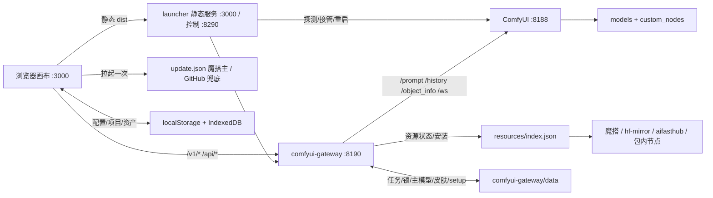

# 无界工作台 · 程序架构

> 截至 2026-10-29，对应发布版本 **v0.21.18**（发布树 `07842353-release-staging`，GitHub `main = 4616c53`）。
> 本文件是架构层权威说明，已纳入 staging git（`docs/ARCHITECTURE.md`），不进发布包。状态与待办见外部 `HANDOFF-NEXT.md`，历史见 `docs/PROJECT_LOG.md`。
> 版本/索引/路由/包数等数字为 2026-10-29 实测（网关单测 135/135）；`docs/` 不入发布包。

## 1. 定位

本地 Windows 上的「无限画布 + 本地 ComfyUI 网关」：画布负责项目、节点、素材与交互；网关把 ComfyUI 工作流包装成 OpenAI 兼容接口；启动器负责探测/接管/拉起 ComfyUI、网关与画布；资源安装器扫描已有模型、按硬件推荐版本、缺什么下什么；更新器每次拉起检查一次远端版本。

## 2. 总览



## 3. 组件职责

| 组件 | 位置 | 职责 |
|---|---|---|
| 启动器 | `launcher/start.mjs`（零依赖） | 探测/接管 ComfyUI；拉起网关；托管画布 dist；控制接口；会话看门狗 |
| 网关 | `comfyui-gateway/src`（32 个模块，约 10k 行） | Express 5；OpenAI 兼容接口；工作流注册/绑定/运行；资源安装；更新；任务；预览 |
| 画布 | `infinite-canvas/web` | React 19 + Vite + Zustand + antd + Tailwind/shadcn；构建为静态 `dist` |
| ComfyUI | 外部（`E:\ComfyUI`） | 执行工作流；模型与自定义节点 |
| 工作流 | `comfyui-gateway/workflows` | 22 个已注册 API 工作流 JSON + `registry.json` |
| 资源安装 | `src/resources.js`（约 2.5k 行）+ `resources/` | 索引/包/依赖；多源下载；节点随包；主模型；硬件推荐 |
| 更新 | `update.json` + `src/update.js` + 画布 hook | 检查、应用、横幅提醒 |

## 4. 启动与接管

1. `start-local.bat` → `launcher/start.mjs`。
2. 探测顺序：安装器同文件夹 → 同盘限深（约 2s）→ 常见目录/配置 → 端口 8188–8199 → 手动配置；已在运行的进程直接接管，绝不重复启动。
3. 网关缺 `express`/`multer` 时自愈：用 `launcher/gateway-deps.zip`（否则魔搭下载 + SHA 校验）解到 `.update/gateway-deps/`。
4. 网关 :8190，环境 `PORT`、`HOST`、`COMFY_URL`、`COMFYUI_DIR`、`COMFY_WORKFLOWS_DIR`、`LAUNCHER_CONTROL_URL`；启动前等 `/health` 30s。
5. setup 可用性缓存的刷新点：启动、工作流目录变化、资源安装/切换主模型/资源刷新；另每 30s 比对模型目录 mtime，变化即重扫（2026-10-29 补：此前网关启动后手动拷入的模型不会重扫，资源中心看得见、模型选择里却不出现）。
6. 画布由启动器在 :3000 托管 dist（SPA 回退、`/assets` 长缓存、路径逃逸 403），每次启动重写 `dist/config.js` 注入网关地址。
7. 控制口 :8290：`GET /health`、`POST /restart-gateway`（接管来的网关返回 409）、`POST /restart-comfy`（taskkill 全部监听 PID → 等端口释放与显存回落 → 重拉 `run_nvidia_gpu.bat` → 重探 8188–8199）。网关以 `/api/system/restart-comfy` 暴露同一能力。
8. 看门狗 5s：时钟跳变 >60s 先静默 120s；要求见过会话、`count==0`、`activeTasks==0`；**只有页面显式关闭**（pagehide/beacon → 网关记录 `closedAt`）且关闭时间在 10 分钟内、空闲 ≥`canvasIdleGraceSec`（默认 30s）才停后台；心跳缺失（后台标签节流/冻结、浏览器崩溃）一律不停，避免挂机被误杀。
9. 显式关闭语义（2026-10-29 补齐）：`sessions.js` 在 `status()` 中返回 `startedAt`/`closedAt`（此前只删会话、不记录关闭时间，导致启动器 `closedAt` 判定永远为假、自动退出实际不生效）；网关重启后 `startedAt` 变化会让启动器重置 `seen`，重新等待画布心跳。旧配置里残留的 15s 默认值会按 30s 处理，需要 15s 可显式设 `CANVAS_IDLE_GRACE_SEC=15`。

## 5. 生成链路

- **图片**：图片节点 → `services/api/image.ts` → `POST /v1/images/generations` / `/edits` → `runner` → `registry` → `bindings` → ComfyUI `/prompt` → 轮询 `/history` → 回传。`count>1` 并发单图；本地加 `X-Request-Id`，取消走 `POST /api/requests/:id/cancel`，进度走 `/api/progress/:requestId`（250ms）。
- **超分**（v0.21.18）：`POST /v1/images/upscale`、`/v1/videos/upscale`；4 条工作流——ESRGAN 快速放大（x2/x4/anime）、ESRGAN 2×（VHS 取帧/合片 + 核心 `UpscaleModelLoader`/`ImageUpscaleWithModel`，不依赖 WAS 节点）、SeedVR2 图片、SeedVR2 视频。
- **H3 视频**：`POST /v1/videos`（multipart，`mode=text|frames|reference`）→ 任务制；`GET /v1/videos/:id`、`/content`、`/cancel`。6 个入口 = VDN 三档（默认）+ 无VDN 三档，共 9 NFE（快速 6 低 + 3 高；质量 5 + 4）。源视频走原生 `LoadVideo → GetVideoComponents` 只取帧，`length` 由 ffprobe 帧数写入；音频由 H3 生成，源音频不保留。
- **插帧**：`POST /v1/videos/interpolate`（RIFE 2×/3×，任务制，生成右侧子视频节点，不覆盖原片）。
- **提示词**：`/v1/prompts/optimize`（H3/生图）、`/optimize-image`、`/caption`（`qwen35|florence|cloud`）。本地走 ComfyUI 工作流，云端走 OpenAI 兼容 `/chat/completions`；云端 Key 只在浏览器 localStorage。H3 云端加载官方 skill（`prompts/skills/h3-prompt-writing/`）。
- **自由卡片**：`/api/free-workflows/*`（导入/扫描/同步/UI 图）+ `/v1/free-workflows/:id/images|videos`；UI 工作流经 `ui-workflow.js` 用 `/object_info` 转成 API 图。
- **预览**：ComfyUI WS → `preview-hub.js` → `GET /api/previews/:promptId`（base64 + `X-Preview-Step/Total`）；`step-plan.js` 估总算子步数，未知节点类别回退到事件步数。

## 6. 工作流与模型

- **注册表 22 条**（实测）：H3 7（`ref2va/t2v/frames` × VDN/无VDN + `character-swap`）、MOSS 6（SFT 8/50、Balanced 8/50、INT8 SFT 8/50）、千问 2.1 4（t2i / edit / inpaint / outpaint，`angle` 隐藏）、Krea2 2（`aesthetics` 隐藏、保留作质量二采）、Z-Image 1、超分 4。
- 工作流是 ComfyUI **API 格式** JSON；`registry.json` 存绑定、参数预设、`baseModels`、可见性默认值；FLUX.2 Klein 在 `workflows/_archive`，未注册。
- `model-paths.js` 统一 10 类模型目录（`MODEL_DIRS`/`MODEL_DIR_KEYS`，含 `upscale_models`、`SEEDVR2`、`vae_approx`、`vdn`）；v0.21.18 起可经 ComfyUI `/internal/folder_paths` 反推安装根，并按 `extra_model_paths` 匹配已装模型。
- 模型权重不进仓库；轮换与烘焙脚本在 `comfyui-gateway/scripts/`（如 `bake-moss-preset.py`）。

## 7. 资源安装

- 索引 `resources/index.json` 版本 **2026.10.29-28**：**8 包 / 72 资源**——`core`（0 资源，按工作流依赖）、`moss` 8/6 工作流、`qwen21` 4/2、`zimage` 4/1、`krea2` 4/1、`h3` 21/7、`prompt-local` 4、`upscale` 11/4（6 权重 + 5 运行库）。
- 依赖以 `workflowDependencies` 按工作流展开，共享资源去重；模型选择器只列 setup 判定可用的工作流，缺资源即从 `/v1/models` 移除。
- **不变量：节点只随包，不写进 `workflowDependencies`**（单测强制）；节点由启动器 `bootstrap-nodes.mjs` 复制到 `custom_nodes/`。
- 运行库（`type:"pip"`）：按 `module` 导入名 + `pipName` 检测是否已装，缺失才装；`wheelMatrix` 条目可只给 `url/size/sha256`（不写 python/torch/cuda 约束）表示纯 Python 通用包，任意运行时都匹配。安装走 `pip install --no-deps`，先备份原包，失败自动回滚；装完重新 import 校验，失败同样回滚。
- 超分运行库（2026-10-29 补）：`seedvr2_dep_diffusers`（diffusers 0.33.1）、`seedvr2_dep_rotary`、`seedvr2_dep_omegaconf`（2.4.0，不再依赖 antlr4）、`seedvr2_dep_opencv`（cv2）、`seedvr2_dep_einops`——全部走阿里云 PyPI 镜像，挂到两条 SeedVR2 工作流；`peft`/`gguf`/`matplotlib` 节点代码未在导入期使用，不随包下发。
- 多源：魔搭主源、hf-mirror / aifasthub 备源；Range 续传，跨源先丢弃旧 `.part`；SHA256 校验；锁 `data/resource-lock.json`；文件并发 2。
- 随包节点（`type=node && autoInstall`）由 `launcher/bootstrap-nodes.mjs` 在启动时复制到 `custom_nodes/`：先解到同盘 `.canvas-install` 再原子 rename；幂等只按「目标目录存在」判断。
- 主模型：`data/main-models.json`。可把已装本地微调设为某包工作流默认底模；被替代的包内默认模型标「已用自选」、不计 missing、不阻塞安装。
- 硬件：`nvidia-smi` 显存 + 系统 RAM；显存只承担激活/工作区，权重超出部分按 ComfyUI 内存卸载计入 RAM；8GB 推荐 INT8；界面不显示 VRAM 数字。
- 许可：CC-BY-NC-SA 模型不随分发源提供（4x-UltraSharp / 4x-AnimeSharp 已从索引与魔搭数据集撤下）。

## 8. 更新链路

- 清单 `update.json`：魔搭主源，GitHub raw 兜底，可用 `UPDATE_MANIFEST_URL(_BACKUP)` 覆盖。
- 应用内：`GET /api/update/check?fetch=1`、`POST /api/update/apply`（有任务在跑返回 409）。git 安装走 `fetch` + `pull --ff-only`（脏树拒绝）；归档安装校验 `size`+`sha256`，支持 `PATCH-DELETE.txt`、`PATCH_PROTECTED` 白名单保护，失败回滚，成功后 1.5s 调 launcher `/restart-gateway`。
- 旧客户端：`patches/update-bridge.zip`（5,735 B）——解析版本 → 下载补丁 → 校验 → 解压时跳过受保护路径 → 备份到 `.update-backup` → 重启。
- 前端：`use-version-check` 每会话检查一次；`UpdateAvailableBanner` 每 10 分钟重查；只提示，不做静默下载/自动重启（用户已否决）。

## 9. 存储

- 浏览器：IndexedDB（项目/节点 400ms 防抖快照、资产库、`image_files`/`image_previews`/`media_files`）；localStorage（配置/主题/插件/皮肤本地状态）。`blob:` 地址不持久，持久引用只有 `storageKey`。
- 网关 `data/`：`tasks.json` + `outputs/`、`setup-status`、`resource-lock`、`main-models`、`workflow-visibility`、`free-workflows.json`、`skin-unlocks.json`。
- 不发布：`data/`、`models/`、`logs`、`launcher/config.json`、`node_modules`。

## 10. 安全

- 默认只绑回环；CORS 白名单；非 GET/HEAD/OPTIONS 的跨站写请求直接 403（校验 `Origin` 与 `Sec-Fetch-Site`）。
- `ALLOW_REMOTE=1` 时 `/api/*` 与 `/admin` 需 `x-gateway-token`；未设令牌启动告警。
- 云端 Base URL 默认拒绝 loopback/内网/link-local/`.local`（`ALLOW_PRIVATE_CLOUD=1` 放行）。
- 导出配置按 `*ApiKey` 后缀脱敏，导入时回填；Key 不进仓库与文档。

## 11. 运行与测试

```bash
# 整套启动
start-local.bat            # 保持画布页打开；关页 30s 后停后台，见 §4.7

# 网关单测（2026-10-29 实测 135/135）
cd 07842353-release-staging/comfyui-gateway
COMFYUI_DIR=E:/ComfyUI/ComfyUI node --test --test-timeout=120000 test/*.test.js

# 前端
cd ../infinite-canvas/web && npm run typecheck && npm run build

# 构建补丁（必须在最后一次 build 之后）
node ../../tools/build-patch.mjs --root ../.. --out ../../patches/v0.21.18.zip --write-manifest
```

端口：画布 3000、启动器控制 8290、网关 8190、ComfyUI 8188（探测 8188–8199）。

## 12. 发布

- 源是 `07842353-release-staging`（唯一 git 仓库）。目标是 GitHub private `main`、魔搭 private dataset `master`（LFS 跟踪 `web/dist` 等，clone 别装 lfs filter 否则拿到指针）、夸克程序包 + 程序升级目录。
- 顺序：改 `VERSION`/`CHANGELOG` → 构建前端 → `build-patch --write-manifest`（白名单打包；守卫：CHANGELOG 必须含该版本、dist 必须引用新 `index-*.js` 且其中含版本串）→ 上传 → 匿名核验。
- 补丁哈希不可复现（tar 时间戳），必须在最后一次构建后写 manifest（`4616c53` 即为补救该问题）。
- `docs/` 与 `tools/` 不进补丁；`resources/bundled/` 与 `resources/loras/*.safetensors` 被 `.gitignore` 排除但发布包需要 → **从 git clone 得到的是轻量版**，完整包只能取补丁/程序包。
- 本文件已提交进 staging git 仅作追溯，不随发布物分发。

## 13. 已知限制 / 待办

- **P1**：LAN/远程网关自动发现与多网关故障切换；桌面包目录名仍为 `无界工作台-v0.21.0`；桌面快捷方式 AV 误报。
- **P2**：已装资源 sha/版本校验；H3 15 个权重缺 sha；真实 GPU TRT 首次编译（需用户授权）；补丁上传脚本化；旧 dist 残留；并发安装无互斥；`present` 只判文件存在；TRT 直写最终路径；`installNode` 的 `bundleDir` 未做根目录包含校验。
- **功能**：Qwen3.5-9B 主模型 5.7GB 与反推推理未实测；VDN 偶发闪烁未彻底解决，无VDN 作为回退；H3 显存接近 32GB。
- **超分**：运行库已接入索引并验证下载/安装/导入（py3.12、无 antlr4），但**没在干净机器上走完整安装流程**；`video-esrgan_2x` 去掉 WAS 依赖后未跑 GPU 出片。

## 14. 交接入口

1. 外部 `HANDOFF-NEXT.md`：当前状态与待办。
2. 本文件：架构与运行链路。
3. `docs/PROJECT_LOG.md`：历史细节（追加式）。
4. 具体行为以 `comfyui-gateway/workflows/*.json`、`resources/index.json`、`comfyui-gateway/src/*` 为准。
